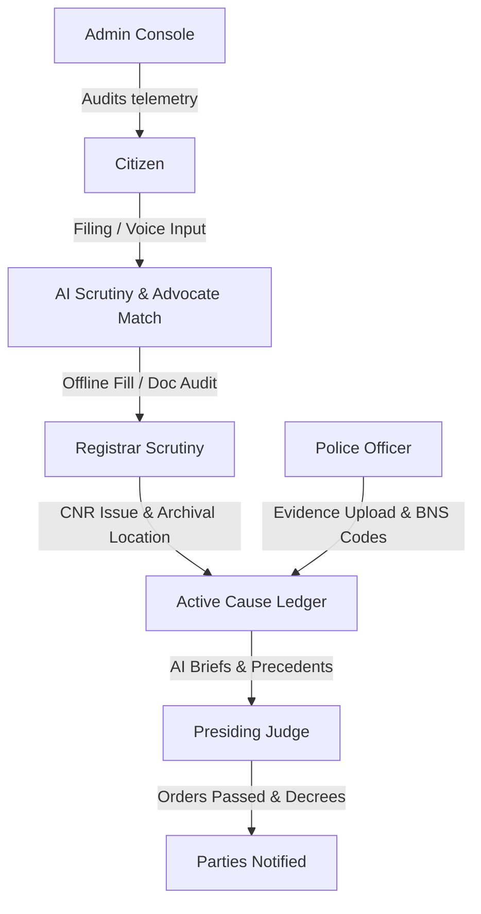
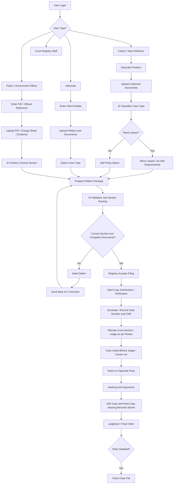

# NyayaFlow ⚖️

> **Indian Judicial Workflow & Document Scrutiny Platform**  
> *Under Human Authority. Structured legal case management for litigants, advocates, police, registrars, and judges.*

NyayaFlow is an intelligent, full-stack judicial workflow management platform designed for the Indian legal ecosystem. It connects citizens, advocates, police officers, registrars, and judges with structured e-filing, real document verification, OCR text extraction, OTP authentication, and an Express/Node.js backend with Supabase (PostgreSQL) cloud integration.

Rather than replacing legal professionals, NyayaFlow acts as an intelligent assistant that reduces paperwork, minimizes procedural errors, and accelerates administrative workflows while ensuring that all legal decisions remain under human authority.
---
**Vision Statement**

"NyayaFlow envisions an India where every citizen can access justice without being overwhelmed by legal complexity, unnecessary paperwork, or procedural delays. By combining Artificial Intelligence with human judicial authority, we aim to build a transparent, efficient, and citizen-centric legal ecosystem."
---
**Problems We Solve**

The Indian judicial system manages millions of cases every year. Despite continuous digitization efforts, several challenges remain.

1️⃣ Incorrect Case Filing

Many citizens are unfamiliar with legal procedures.

They often do not know:

Which court has jurisdiction.
Which type of petition should be filed.
Which documents are mandatory.
Whether the dispute is civil, criminal, consumer, cyber, or family-related.

This frequently results in:

Rejected petitions
Incorrect filings
Long delays
Multiple court visits
NyayaFlow Solution

Our AI analyzes the dispute in natural language and recommends:

Appropriate case category
Court jurisdiction
Required supporting documents
Filing checklist
2️⃣ Physical Document Storage

Even today, courts maintain enormous collections of physical records.

Problems include:

Lost files
Damaged documents
Difficult retrieval
High storage costs
Duplicate records

Finding a case file can sometimes take hours or days.

NyayaFlow Solution

Every petition receives a secure digital profile containing:

Petition
Evidence
Court orders
Judgments
Hearing history
Archive location

Documents become searchable instantly.

3️⃣ No Digital Verification Before Physical Submission

Citizens currently submit original documents without prior validation.

If documents contain:

Missing signatures
Wrong formats
Missing annexures
Poor scan quality

they must visit the court repeatedly.

NyayaFlow Solution

NyayaFlow introduces a Digital Pre-Scrutiny Workflow.

Citizen Uploads Documents

↓

AI Document Audit

↓

Missing Document Detection

↓

Registrar Verification

↓

Approval

↓

Physical Document Submission

Original documents are submitted only after digital verification.

This reduces unnecessary visits and administrative delays.

4️⃣ Lack of Transparency

Citizens often have little visibility into:

Petition status
Verification progress
Hearing schedules
Registrar actions
NyayaFlow Solution

Real-time dashboards display:

Filing status
Registrar approval
Police investigation
Court hearings
Final judgment
5️⃣ Manual Administrative Work

Court staff manually:

Register petitions
Verify documents
Categorize disputes
Assign departments

This consumes valuable time.

NyayaFlow Solution

AI automates repetitive administrative tasks while keeping final approval under human control.

6️⃣ Fragmented Communication

Currently,

Citizen

↓

Advocate

↓

Police

↓

Registrar

↓

Judge

often use disconnected systems.

NyayaFlow connects all stakeholders through one unified platform.
## 🏛️ Project Architecture & Stakeholder Portals

NyayaFlow connects six primary judicial stakeholders:


**System Flowchart**



1. **Citizen / Litigant** (`/citizen/dashboard`):
   - Regional language grievance filing narrative & real microphone voice dictation (Groq Whisper Large v3).
   - Statutory acts and document requirement checklists.
   - Real drag-and-drop document upload (PDF, JPG, PNG) and camera scanning.
   - Live tracking of registered case dossiers by CNR number.
2. **Advocate Counsel** (`/advocate/dashboard`):
   - Review incoming client inquiries and statutory briefs.
   - Inspect client annexures prior to registry scrutiny.
   - Confirm and sign Vakalatnama representation (Rule 4 BCI).
3. **Police Officer** (`/police/dashboard`):
   - Input First Information Report (FIR) narratives with BNS legal section suggestions.
   - Bharatiya Nyaya Sanhita (BNS) section recommendations with officer verification.
   - Attach digital evidence with SHA-256 integrity checksums under Section 63 BSA.
4. **Court Registrar** (`/registrar/dashboard`):
   - Order 4 CPC procedural defect scrutiny verification.
   - Assign official 16-character Case Number Record (CNR) numbers.
   - Log physical court archive room, shelf, and box storage locations.
5. **Presiding Judge** (`/judge/dashboard`):
   - Access daily cause lists and chronological hearing digests.
   - Review applicable statutory sections and precedent citations.
   - Record and sign reasoned bench decrees and interim injunctions (CPC Order 39).
6. **System Administrator** (`/admin/dashboard`):
   - Monitor backend API health, OCR engine status, and database connections.
   - Immutable security and transactional audit trail logging.

---

## 🎨 Judicial Dark Stone Theme

- **Primary background:** Deep Warm Charcoal (`#12100e`)
- **Primary text:** Clean Off-White (`#F8FAFC`)
- **Accent:** Warm Judicial Gold (`#C49752`)
- **Secondary background:** Warm Muted Stone (`#1C1917`)
- **Borders:** Subdued Border (`#292524`)
- **Buttons:** High-contrast solid stone with gold/amber hover
- **Typography:** Inter / System UI sans-serif for optimal legibility across mobile, tablet, and desktop.
- Unnecessary decorative animations, gradients, and promotional AI fluff have been completely removed.

---

## ⚙️ Tech Stack

* **Frontend:** Next.js 16 (App Router), React 19, TypeScript, Tailwind CSS v4, Lucide Icons, Framer Motion.
* **Backend:** Node.js, Express.js.
* **Database:** Supabase Cloud (PostgreSQL) — single source of truth across all machines and deployments.
* **AI & LLM:** Groq Cloud API (Llama 3.3 / Groq models & Whisper Large v3 for Voice Dictation STT).
* **File Upload:** Multer with strict MIME validation (PDF, JPG, JPEG, PNG), 15 MB size limit, and sanitized server-side filenames.
* **OCR & Scanning:** `pdf-parse` (digital PDF direct text extraction) & `tesseract.js` (optical character recognition for scanned images).
* **Authentication:** Cryptographic OTP (HMAC-SHA256, 10-minute expiry, 60s cooldown timer, rate limiting, and Nodemailer SMTP delivery integration).

---

## 📂 Project Structure

```text
nyaya_flow/
├── backend/
│   ├── config/
│   │   └── database.js       # Mongoose connection & local persistence fallback
│   ├── controllers/
│   │   ├── authController.js     # OTP send, verify, login, register, logout
│   │   ├── documentController.js # Upload, list, retrieve, stream download, delete
│   │   └── scanController.js     # OCR scan trigger, scan-status, scan-result
│   ├── middleware/
│   │   ├── authMiddleware.js     # JWT token verification
│   │   ├── uploadMiddleware.js   # Multer storage, mime verification, size limits
│   │   └── errorMiddleware.js    # Centralized JSON error handling
│   ├── models/
│   │   ├── User.js               # User accounts & roles
│   │   ├── Document.js           # Document metadata, storage path, scan results
│   │   ├── OTP.js                # Hashed OTPs, expiry, rate limiting
│   │   └── storageHelper.js      # Resilient local JSON storage engine
│   ├── routes/
│   │   ├── authRoutes.js         # /api/auth/*
│   │   ├── documentRoutes.js     # /api/documents/*
│   │   └── courtRoutes.js        # Court petitions, advocates, classification
│   ├── services/
│   │   ├── otpService.js         # Crypto OTP generator & email delivery
│   │   └── scanningService.js    # PDF text extraction & Tesseract OCR
│   ├── uploads/                  # Secure filesystem storage for uploaded files
│   ├── .env.example              # Documented environment variables
│   ├── package.json              # Backend dependencies
│   └── server.js                 # Express server entrypoint (Port 5000)
├── frontend/
│   ├── src/
│   │   ├── app/
│   │   │   ├── auth/page.tsx         # Role sign-in with real OTP verification
│   │   │   ├── citizen/dashboard/    # Litigant filing, real upload & OCR review
│   │   │   ├── advocate/dashboard/   # Counsel brief management & vakalatnama
│   │   │   ├── police/dashboard/     # FIR entry, BNS mapper & evidence upload
│   │   │   ├── registrar/dashboard/  # Scrutiny checklist & CNR allocator
│   │   │   ├── judge/dashboard/      # Cause list & bench order signing
│   │   │   ├── admin/dashboard/      # Health metrics & immutable audit trail
│   │   │   ├── globals.css           # Clean B&W theme variables & utilities
│   │   │   └── layout.tsx            # Inter typography & minimal layout
│   │   ├── components/
│   │   │   └── document-upload.tsx   # Drag-and-drop, camera scan & progress UI
│   │   └── utils/
│   │       └── api.ts                # Centralized client for real backend APIs
│   ├── public/                       # Static public assets and courthouse illustrations
│   ├── next.config.ts                # API rewrites proxying /api/* to port 5000
│   └── package.json                  # Frontend dependencies
├── package.json                      # Root workspace orchestrator
└── vercel.json                       # Vercel deployment configuration
```

---

## 🚀 Quick Start Guide

### Option A: From Workspace Root (One-Click)

```bash
# Run both frontend & backend concurrently
npm run dev:all

# Or run frontend only
npm run dev

# Or run backend only
npm run dev:backend
```

### Option B: Individual Services

#### 1. Start the Backend Server (Express + Node.js)

```bash
cd backend
npm install
node server.js
```
The backend server runs on `http://127.0.0.1:5000`.

#### 2. Start the Frontend (Next.js)

```bash
cd frontend
npm install
npm run dev
```
Open **`http://localhost:3000`** in your browser.

---

## 🔑 OTP Authentication & Testing

1. Navigate to [http://localhost:3000/auth](http://localhost:3000/auth).
2. Select your stakeholder role (Citizen, Advocate, Police Officer, Registrar, Judge, or Admin).
3. Click **Send OTP**.
4. In development mode without an SMTP provider configured, the secure 6-digit OTP is generated and printed directly to the backend terminal console. Enter the 6-digit code and click **Verify OTP & Enter Portal**.
5. Once configured with SMTP credentials in `backend/.env`, the OTP is delivered via email.

---

## 📄 Real Document Upload & OCR Scanning

1. Open the Citizen Dashboard at [http://localhost:3000/citizen/dashboard](http://localhost:3000/citizen/dashboard).
2. Go to **Step 3 (Upload & Scrutiny)** or switch to the **Document Repository** tab.
3. Drag & drop or browse a PDF, JPG, or PNG document (or click **Camera Scan** on supported devices).
4. Click **Upload Document**. The file is validated and stored on the backend disk in `backend/uploads/` with a record saved in the database.
5. Click **Scan & Extract Text**. Direct PDF parsing or Tesseract OCR extracts the text, identifies the legal document type (e.g., Aadhaar Card, 7/12 Land Extract, Court Order), counts words, and displays editable results.

---
**Objectives**

NyayaFlow aims to:

✅ Reduce filing errors

✅ Minimize paperwork

✅ Improve transparency

✅ Digitize judicial workflows

✅ Assist legal professionals with AI

✅ Improve access to justice
---
**Key Innovations**

AI Petition Intelligence

Automatically understands complaints and categorizes legal disputes.

Digital Case Repository

Every case contains:

Documents
Evidence
Hearing history
Court orders
Archive references
Smart Document Health Audit

Checks:

✔ Missing pages

✔ Missing signatures

✔ Invalid file formats

✔ OCR readability

✔ Mandatory documents

before submission.

Advocate Recommendation

Citizens receive advocate suggestions based on:

Practice area
Location
Court jurisdiction
Judicial Brief Generator

Instead of reading hundreds of pages,

Judges receive concise AI-generated summaries containing:

Facts
Timeline
Previous hearings
Relevant precedents
Registrar Archive Mapping

Physical files remain traceable.

Building

↓

Floor

↓

Room

↓

Shelf

↓

Box

↓

Case File

Digital records always know where the original file is stored.

Police Investigation Workspace

Police officers can:

Upload evidence
Link forensic reports
Suggest BNS sections
Generate investigation summaries
---
**Why NyayaFlow Matters**

NyayaFlow is not merely another e-filing portal.

It creates a complete digital judicial ecosystem where:

Citizens understand legal procedures.
Registrars verify digitally before physical filing.
Police manage evidence efficiently.
Advocates collaborate through one platform.
Judges receive intelligent summaries instead of massive case bundles.
---
** System Workflow**
Citizen

↓

AI Legal Assistant

↓

Petition Generation

↓

Document Upload

↓

AI Document Audit

↓

Registrar Verification

↓

Physical Submission

↓

Official CNR Registration

↓

Police Investigation

↓

Court Proceedings

↓

Judgment

↓

Digital Archive
---
**AI Features**
Intelligent Petition Classification
Legal Document Summarization
OCR Verification
Missing Document Detection
Court Recommendation
BNS Suggestion Engine
Cause List Briefing
Multilingual Support
AI Legal Guidance

---

## ⚖️ Strict Sovereign AI Safe-Use Guardrails

1. **Human Authority**: AI provides advisory summaries and checklists, but never issues final binding orders or assigns CNR numbers autonomously.
2. **Cryptographic Integrity**: Evidence files generate SHA-256 hashes upon upload under Section 63 BSA.
3. **Auditability**: Every major state transaction records an immutable log with actor, role, IP, and timestamp.

---

## 🔒 Environment Variables (`backend/.env`)

Copy `backend/.env.example` to `backend/.env`:
```env
PORT=5000
JWT_SECRET=your_jwt_secret_key_here

# Supabase PostgreSQL Cloud Database
SUPABASE_URL=https://your-project-id.supabase.co
SUPABASE_ANON_KEY=your_supabase_anon_key_here
SUPABASE_SERVICE_ROLE_KEY=your_supabase_service_role_key_here

# Groq Cloud AI (LLM Chat & Whisper STT Dictation)
GROQ_API_KEY=gsk_your_groq_api_key_here

# Email OTP Delivery (Optional)
SMTP_HOST=smtp.gmail.com
SMTP_PORT=587
SMTP_USER=your_email@gmail.com
SMTP_PASS=your_app_password
EMAIL_FROM="NyayaFlow Judiciary" <no-reply@nyayaflow.gov.in>
```
*(If Supabase credentials are not provided, the backend seamlessly operates in in-memory mode so you can test features immediately without any local database requirements).*

